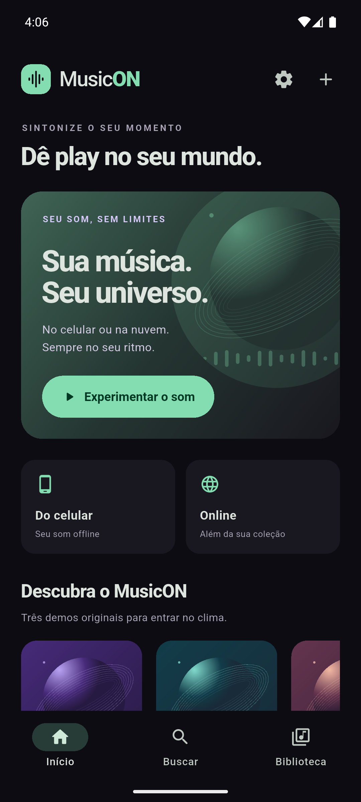

# MusicON

Player Android em Flutter com identidade própria, busca online, músicas do aparelho, favoritos, playlists, temas e atualização pelo GitHub.

[Baixar APK](https://github.com/lenonronaldo2014-prog/MusicON/releases/latest) · [Configurar Spotify](docs/spotify-setup.md) · [Privacidade](docs/privacy.md)

 

 

## Versão 0.6.0

- Tela inicial original preservada e navegação Início / Buscar / Biblioteca.
- Busca de músicas e artistas com NewPipeExtractor v0.27.0, até 20 resultados por consulta, sem login do YouTube.
- Capas/miniaturas reais quando fornecidas pela fonte; imagem ilustrada de reserva. Miniatura de vídeo não garante uma capa oficial de álbum.
- Importação de arquivos locais, favoritos e playlists salvas no aparelho.
- Filas em sequência ou aleatório, anterior, próxima, repetição e reprodução em segundo plano.
- Seis cores salvas por usuário no aparelho: violeta, azul, verde, rosa, dourado e coral.
- Consulta à última Release pública no GitHub e opção de verificar novidades ao abrir.
- Download completo de músicas ou de uma coleção para ouvir offline.
- Integração opcional de playlists Spotify implementada, aguardando o cadastro descrito abaixo.

## Ouvir offline

No menu de uma música, escolha **Disponibilizar offline**. Na playlist, use o ícone de download para colocar as faixas na fila. Na biblioteca/favoritas existe também a ação para disponibilizar a coleção.

**Biblioteca > Downloads** mostra o progresso, permite cancelar, tentar novamente, tocar o arquivo ou remover o download. **Mantenha o MusicON aberto durante o download.** A fila é sequencial e admite até 100 registros; limpe o histórico finalizado quando precisar. O limite é de 256 MB por arquivo.

O app salva o áudio completo no armazenamento privado. O ID da faixa permanece igual: favoritos e playlists passam a usar a cópia local, inclusive quando o resultado aparece novamente na busca. Remover o download mantém a música na coleção para reprodução online. Arquivos incompletos não são marcados como prontos, e a recuperação da fila verifica a presença dos arquivos. As capas podem depender da rede quando não estiverem no cache de imagens.

Os endereços temporários de mídia são resolvidos quando necessários e não são salvos na biblioteca ou no histórico de downloads. Alterações na fonte, disponibilidade do conteúdo e bloqueios podem impedir uma busca, reprodução ou download. Não há suporte a conteúdo protegido/restrito, login YouTube ou DRM.

## Spotify opcional

Abra **Biblioteca > Importar do Spotify** ou **Configurações > Spotify**. A integração usa a API oficial para ler as playlists autorizadas pela conta, inclusive por link quando acessível. O usuário escolhe as versões encontradas no MusicON antes de salvar uma coleção, na ordem original. A importação pode ser parcial, e a versão escolhida pode ser diferente da gravação listada no Spotify.

**O login ainda não está ativado no APK 0.6.0: falta cadastrar o MusicON e fornecer o Client ID público.** A tela informa que a conexão está em preparação, sem simular login. O fluxo implementado foi testado com retorno real em loopback e respostas simuladas da API; a conexão de uma conta Spotify real continua pendente.

O código utiliza Authorization Code com PKCE S256, valida `state`, guarda tokens cifrados com uma chave do Android Keystore, renova a sessão e permite desconectar. Não há Client Secret no APK. A integração fornece a lista de faixas, não arquivos de áudio do Spotify. O offline utiliza a fonte das versões que o usuário selecionou no MusicON.

Veja o [guia de ativação](docs/spotify-setup.md), incluindo Client ID, redirecionamento e limites do modo de desenvolvimento, e a [política de privacidade](docs/privacy.md).

## Compilar

Use Flutter 3.41.5 / Dart 3.11.3, Java do Android Studio e Android SDK. Android mínimo API 24. A primeira compilação baixa dependências Maven Central, Google e JitPack.

```powershell
flutter pub get
flutter analyze
flutter test
flutter run
flutter build apk --release -t lib/main_newpipe.dart
```

`lib/main.dart` encaminha para `main_newpipe.dart`. A configuração do VS Code também usa essa entrada. O identificador do pacote continua `com.musicon.musicon.prototype`, agora com o nome visível **MusicON**, para atualizar a instalação de teste sem perder a biblioteca. O projeto antigo em outra pasta não é modificado.

Os APKs atuais usam a mesma chave local de desenvolvimento das entregas anteriores. Nenhuma chave privada acompanha o repositório. Preserve essa chave para publicar atualizações compatíveis; mudar a assinatura exige outra instalação. Estes APKs são entregas para testes, não versões de loja.

## Validação

A análise estática passou sem problemas e os **40 testes automatizados** passaram. Eles cobrem a biblioteca, filas, armazenamento, temas, atualizações, downloads incompletos, remoção de arquivos, recuperação e integração Spotify. Os testes de API simulam as respostas externas; isso não substitui um login real.

Ensaio offline 0.6.0 no emulador:

- Download de **10.202.210 bytes** do filme público Big Buck Bunny, da Blender Foundation.
- Arquivo recuperado pela biblioteca salva, com fonte local.
- Wi-Fi e dados móveis desligados; Android confirmou `Active default network: none`.
- Player avançou até três segundos usando `TrackSource.local`.
- O ensaio também confirmou escrita/leitura do armazenamento cifrado nativo com um valor de teste, apagado ao final.

O APK release final também foi validado pela tela Downloads com rede desligada: posição de reprodução de 6.014 ms antes de pausar, sem erro registrado do player.

O relato anterior de áudio picotando/distorcido seguido de silêncio no emulador continua exigindo comparação com celular físico. Compilar em release e ver a posição avançar não comprova qualidade audível; esta entrega não declara esse problema resolvido.

Ensaio optativo de desenvolvimento:

```powershell
flutter run -t lib/main_newpipe.dart --dart-define=NEWPIPE_OFFLINE_PROBE=true
```

Quando `MUSICON_OFFLINE_PROBE ready_for_disconnect` aparecer, desligue a rede do emulador. O ensaio aguarda 12 segundos antes de tocar o arquivo local e grava `app_flutter/offline-probe.json`. O APK público é compilado em release sem essa opção. Existe também o ensaio anterior `--dart-define=NEWPIPE_PROBE=true` para reprodução com tela apagada.

## Publicar uma atualização

1. Incremente versão e build em `pubspec.yaml`, por exemplo `0.6.1+8`.
2. Execute análise e testes, e gere o APK release com a mesma assinatura. Inclua o Client ID público na compilação caso a integração Spotify já esteja cadastrada.
3. Faça commit do código correspondente.
4. Publique uma Release pública com tag `v0.6.1` apontando para esse commit e anexe o APK com o nome exato **MusicON.apk**. Não marque como pré-lançamento para que a consulta de atualização o encontre.

A consulta utiliza `GET /repos/lenonronaldo2014-prog/MusicON/releases/latest`, sem autenticação ou token GitHub dentro do aplicativo. O download abre no navegador; a instalação é confirmada pelo Android. Falhas de rede e limites públicos do GitHub são informados no botão de consulta.

## Licença

GPL-3.0-or-later, conforme [LICENSE](LICENSE). As dependências mantêm suas licenças. O projeto é independente, sem patrocínio ou afiliação a Spotify, YouTube ou NewPipe.

Os fontes e a licença do NewPipeExtractor acompanham `third_party`, e as versões de dependências estão registradas no Gradle e `pubspec.lock`. O transporte de áudio usa POST e intervalos de bytes conforme o [NewPipe](https://github.com/TeamNewPipe/NewPipe/blob/dev/app/src/main/java/org/schabi/newpipe/player/datasource/YoutubeHttpDataSource.java), com HTTPS e HTTP permitido apenas no loopback local do player. A implementação usa a API experimental `StreamAudioSource` do just_audio 0.10.6.
