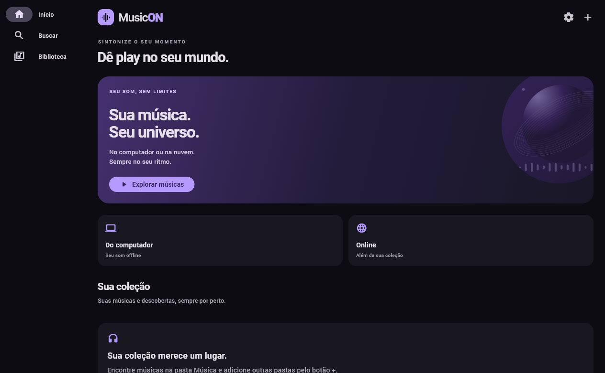
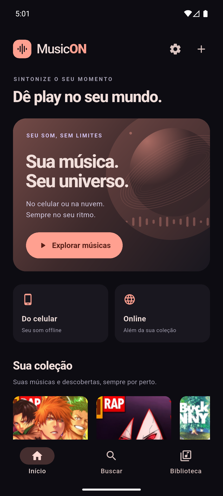
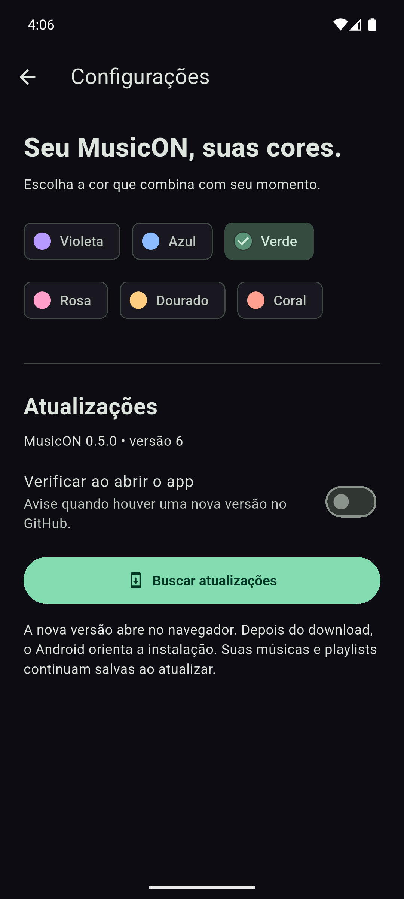
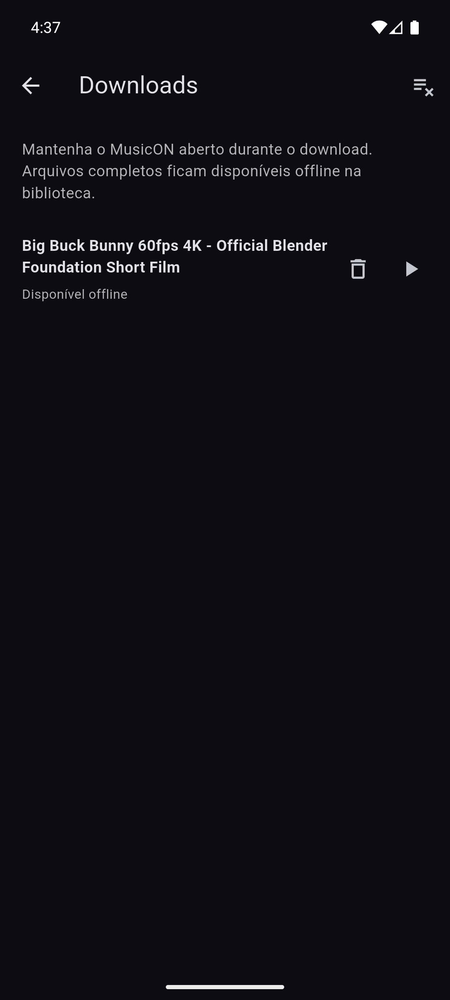
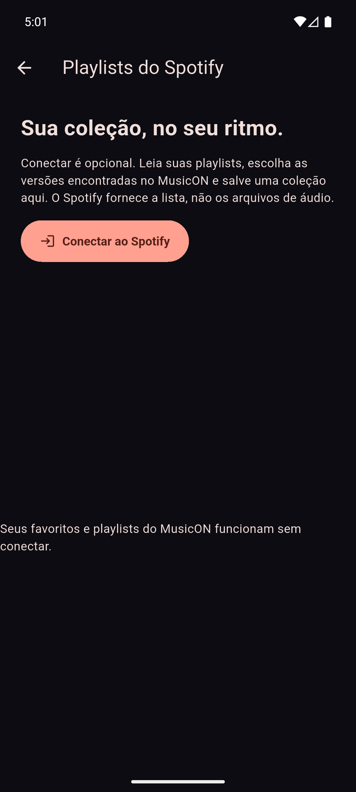

# MusicON

Player Android e Windows em Flutter com identidade própria, busca online, músicas locais, favoritos, playlists, temas e atualização pelo GitHub.

[Baixar para Android ou Windows](https://github.com/lenonronaldo2014-prog/MusicON/releases/latest) · [Configurar Spotify](docs/spotify-setup.md) · [Privacidade](docs/privacy.md)

[Versão Windows e instalação](docs/windows.md)



 

 

## Versão 0.8.2

- Corrigido o encerramento do MusicON no Windows com áudio ativo: o player é liberado antes de a janela fechar.

## Versão 0.8.1

- Volume do MusicON ajustável no player do Windows, com o nível salvo ao fechar o aplicativo.

## Versão 0.8.0

- Primeira versão Windows x64, com instalador e ZIP sem instalação, preservando a identidade visual do MusicON.
- Navegação lateral em telas largas, músicas das pastas do computador, favoritos, playlists, temas, player e busca online.
- Player Windows por media_kit; NewPipeExtractor executado localmente com runtime incluído, sem exigir Java instalado.
- Spotify pelo navegador no Windows, com sessão cifrada pelo DPAPI da conta do usuário.
- Atualização pelo GitHub escolhe o APK no Android e o instalador no Windows.

- Corrigida a leitura de respostas da busca em Android anterior ao 13: a chamada `InputStream.readNBytes`, ainda presente no DEX anterior, foi substituída por leitura limitada compatível com Android 7+.
- Falhas de compatibilidade do extrator são apresentadas na tela em vez de encerrar o processo por `LinkageError`.
- Configurações > Diagnóstico de problemas permite copiar um relatório local com versão, modelo, Android, erros técnicos e motivos de encerramento registrados pelo sistema (Android 11+).
- O diagnóstico não armazena mensagens de exceção, URLs, senhas, tokens ou nomes de músicas. Não há envio automático.

- Os dois modos de login Spotify usam retorno direto ao Android por `musicon://spotify/callback`, sem servidor HTTP em segundo plano.
- Corrigido o caso em que o Android congelava o MusicON enquanto o navegador estava aberto e o retorno ficava sem resposta.
- Acesso negado ao listar playlists agora orienta conferir Premium na conta responsável pelo cadastro e a lista de usuários autorizados.

- Conexão HTTPS com Spotify pelo cliente nativo Android com OkHttp, sem usar os sockets do Dart.
- Escolha entre login pelo aplicativo Spotify compatível instalado e pelo navegador. O login nativo usa Spotify Android Auth 5.0.0 com PKCE e precisa do cadastro Android descrito no guia.
- O retorno do navegador reabre a Activity do MusicON; a autorização antiga deve ser fechada após atualizar.
- Falhas temporárias de DNS na conexão e nas consultas ao Spotify recebem até duas novas tentativas, com intervalo curto.
- Falhas persistentes mostram orientação de rede em português e permitem tentar conectar novamente. A sessão já salva é preservada quando a rede falha; respostas HTTP e timeouts não são repetidos automaticamente.

- Tela inicial original preservada e navegação Início / Buscar / Biblioteca.
- Busca de músicas e artistas com NewPipeExtractor v0.27.0, até 20 resultados por consulta, sem login do YouTube.
- Capas/miniaturas reais quando fornecidas pela fonte; imagem ilustrada de reserva. Miniatura de vídeo não garante uma capa oficial de álbum.
- Leitura automática das músicas do celular pelo MediaStore, com permissão de áudio do Android, atualização ao voltar ao app e acompanhamento de mudanças no catálogo.
- Favoritos e playlists salvas no aparelho, sem músicas demo incluídas.
- Exclusão de arquivos do celular pelo menu, com confirmação do app e do Android quando exigida. Faixas online não oferecem exclusão do arquivo original.
- O seletor de arquivos continua disponível como opção adicional.
- Filas em sequência ou aleatório, anterior, próxima, repetição e reprodução em segundo plano.
- Seis cores salvas por usuário no aparelho: violeta, azul, verde, rosa, dourado e coral.
- Consulta à última Release pública no GitHub e opção de verificar novidades ao abrir.
- Download completo de músicas ou de uma coleção para ouvir offline.
- Integração opcional de playlists Spotify configurada com o Client ID público do MusicON e retorno `musicon://spotify/callback`.

## Músicas do celular

Na primeira execução, permita ao MusicON acessar músicas e áudio. O aplicativo consulta o índice MediaStore do Android sem copiar cada arquivo para seu armazenamento privado. Novos arquivos são atualizados automaticamente, e o catálogo é consultado ao voltar ao app. O botão **Do celular** abre a biblioteca local; **Atualizar músicas do celular** permite refazer a leitura. Se a permissão for negada, a biblioteca mostra como permitir o acesso ou abrir as configurações do Android.

A leitura inclui arquivos marcados como música pelo catálogo do sistema. Não acessa arquivos privados/protegidos de outros aplicativos. Os downloads internos do MusicON continuam separados da biblioteca compartilhada, evitando indexar a mesma cópia novamente.

No menu de um arquivo do aparelho, escolha **Excluir música do aparelho**. O app pede confirmação e utiliza o consentimento do Android quando exigido. Cancelar mantém o arquivo. Depois de excluir, o item sai dos favoritos, das playlists e da fila de reprodução. Cópias importadas anteriormente pelo seletor têm confirmação específica para excluir a cópia privada. O download de uma faixa online continua usando **Remover download**, que preserva sua referência na coleção.

As demos antigas foram retiradas dos assets e seus itens são descartados ao recuperar a biblioteca. A identidade visual e o desenho da tela inicial permanecem; o cartão agora abre a busca e a seção Sua coleção mostra músicas reais.

## Ouvir offline

No menu de uma música, escolha **Disponibilizar offline**. Na playlist, use o ícone de download para colocar as faixas na fila. Na biblioteca/favoritas existe também a ação para disponibilizar a coleção.

**Biblioteca > Downloads** mostra o progresso, permite cancelar, tentar novamente, tocar o arquivo ou remover o download. **Mantenha o MusicON aberto durante o download.** A fila é sequencial e admite até 100 registros; limpe o histórico finalizado quando precisar. O limite é de 256 MB por arquivo.

O app salva o áudio completo no armazenamento privado. O ID da faixa permanece igual: favoritos e playlists passam a usar a cópia local, inclusive quando o resultado aparece novamente na busca. Remover o download mantém a música na coleção para reprodução online. Arquivos incompletos não são marcados como prontos, e a recuperação da fila verifica a presença dos arquivos. As capas podem depender da rede quando não estiverem no cache de imagens.

Os endereços temporários de mídia são resolvidos quando necessários e não são salvos na biblioteca ou no histórico de downloads. Alterações na fonte, disponibilidade do conteúdo e bloqueios podem impedir uma busca, reprodução ou download. Não há suporte a conteúdo protegido/restrito, login YouTube ou DRM.

## Spotify opcional

Abra **Biblioteca > Importar do Spotify** ou **Configurações > Spotify**. A integração usa a API oficial para ler as playlists autorizadas pela conta, inclusive por link quando acessível. O usuário escolhe as versões encontradas no MusicON antes de salvar uma coleção, na ordem original. A importação pode ser parcial, e a versão escolhida pode ser diferente da gravação listada no Spotify.

**O Client ID público foi configurado no APK 0.7.0.** Desde 0.7.2, os dois modos usam `musicon://spotify/callback`, aceito no cadastro do projeto. O navegador retorna diretamente ao Android, que reabre o MusicON mesmo após congelamento em segundo plano. O acesso às playlists continua sujeito ao cadastro, à conta autorizada e ao Premium da conta responsável pelo aplicativo. Não é necessário conectar para usar o restante do app.

O código utiliza Authorization Code com PKCE S256, valida `state`, guarda tokens cifrados com uma chave do Android Keystore, renova a sessão e permite desconectar. Não há Client Secret no APK. A integração fornece a lista de faixas, não arquivos de áudio do Spotify. O offline utiliza a fonte das versões que o usuário selecionou no MusicON.

Veja o [guia de ativação](docs/spotify-setup.md), incluindo Client ID, redirecionamento e limites do modo de desenvolvimento, e a [política de privacidade](docs/privacy.md).

## Compilar

Use Flutter 3.41.5 / Dart 3.11.3, Java do Android Studio e Android SDK. Android mínimo API 24. A primeira compilação baixa dependências Maven Central, Google e JitPack.

```powershell
flutter pub get
flutter analyze
flutter test
flutter run
flutter build apk --release -t lib/main_newpipe.dart
```

`lib/main.dart` encaminha para `main_newpipe.dart`. A configuração do VS Code também usa essa entrada. O identificador do pacote continua `com.musicon.musicon.prototype`, agora com o nome visível **MusicON**, para atualizar a instalação de teste sem perder a biblioteca. O projeto antigo em outra pasta não é modificado.

Os APKs atuais usam a mesma chave local de desenvolvimento das entregas anteriores. Nenhuma chave privada acompanha o repositório. Preserve essa chave para publicar atualizações compatíveis; mudar a assinatura exige outra instalação. Estes APKs são entregas para testes, não versões de loja.

## Validação

Na versão 0.8.0, o pacote Windows x64 foi compilado pelo workflow e executado no Windows. A conferência do executável exportou a tela inicial, recebeu 20 resultados reais da busca e confirmou avanço de reprodução local e online sem erro do player. O instalador foi executado com sucesso e instalou a versão 0.8.0+12. O APK 0.8.0 também foi instalado no emulador: a reprodução online chegou a 17.086 ms antes de pausar, sem erro registrado. Isso não mede a qualidade de áudio de cada dispositivo nem substitui testar um login real do Spotify.

A análise estática passou sem problemas. Os **62 testes Flutter e 4 testes nativos da leitura limitada** passaram. Eles cobrem a biblioteca, filas, armazenamento, temas, atualizações por plataforma, downloads incompletos, remoção de arquivos, recuperação, integração Spotify, diagnóstico local, pastas do Windows e proteção da sessão por DPAPI. Os testes de API simulam as respostas externas; isso não substitui um login real.

O registro nativo foi validado com um encerramento controlado pelo ADB no emulador: o relatório preservou a classe da exceção e as posições de código, delegando ao tratamento original do Android. Esse encerramento foi provocado para teste; a causa dos fechamentos no celular do amigo do usuário ainda não foi confirmada. Após um novo fechamento, reabra o app e copie o relatório em Configurações > Diagnóstico de problemas. Em Android anterior ao 11, o histórico de encerramentos do sistema não está disponível; os registros próprios permanecem disponíveis quando puderem ser salvos.

Na versão 0.7.2, o teste de retorno colocou explicitamente o processo do MusicON no estado `isFrozen=true` com o navegador em primeiro plano. O deep link reabriu o app, um retorno com estado incorreto foi ignorado e o código de teste com estado válido foi entregue ao login pendente. O teste não solicitou aprovação de uma conta Spotify nem armazenou tokens reais. O bloqueio de Web API por ausência de Premium no cadastro foi confirmado pelo aviso do painel enviado pelo usuário; a atualização não remove essa exigência externa.

Na versão 0.7.1, o ensaio de rede Android alcançou os endpoints oficiais de token e playlists por HTTPS, recebendo 400/401 com credenciais de teste inválidas. O canal nativo rejeitou outro domínio. Um retorno de autorização simulado, aberto no Chrome do emulador, trouxe o MusicON para a frente. O emulador não possui Spotify instalado; o login nativo foi verificado com respostas simuladas e ainda precisa de teste em aparelho com Spotify e cadastro Android concluído.

Bibliotecas adicionais: [Spotify Android Auth 5.0.0](https://github.com/spotify/android-auth) e [OkHttp 4.12.0](https://github.com/square/okhttp), ambas sob Apache 2.0, com licenças em `third_party/`.

Ensaio offline 0.6.0 no emulador:

- Download de **10.202.210 bytes** do filme público Big Buck Bunny, da Blender Foundation.
- Arquivo recuperado pela biblioteca salva, com fonte local.
- Wi-Fi e dados móveis desligados; Android confirmou `Active default network: none`.
- Player avançou até três segundos usando `TrackSource.local`.
- O ensaio também confirmou escrita/leitura do armazenamento cifrado nativo com um valor de teste, apagado ao final.

O APK release final também foi validado pela tela Downloads com rede desligada: posição de reprodução de 6.014 ms antes de pausar, sem erro registrado do player.

O fluxo local 0.7.0 foi verificado no emulador: um WAV de teste apareceu automaticamente pelo MediaStore, tocou por URI de conteúdo e alcançou 3.232 ms antes de pausar. Negar a confirmação de exclusão do Android manteve o arquivo; permitir removeu o arquivo, a entrada da biblioteca e o item do player. A revogação e a concessão de acesso à mídia também foram exercitadas. Os arquivos de teste foram gerados para validação, não fazem parte do APK.

O relato anterior de áudio picotando/distorcido seguido de silêncio no emulador continua exigindo comparação com celular físico. Compilar em release e ver a posição avançar não comprova qualidade audível; esta entrega não declara esse problema resolvido.

Ensaio optativo de desenvolvimento:

```powershell
flutter run -t lib/main_newpipe.dart --dart-define=NEWPIPE_OFFLINE_PROBE=true
```

Quando `MUSICON_OFFLINE_PROBE ready_for_disconnect` aparecer, desligue a rede do emulador. O ensaio aguarda 12 segundos antes de tocar o arquivo local e grava `app_flutter/offline-probe.json`. O APK público é compilado em release sem essa opção. Existe também o ensaio anterior `--dart-define=NEWPIPE_PROBE=true` para reprodução com tela apagada.

## Publicar uma atualização

1. Incremente versão e build em `pubspec.yaml`, por exemplo `0.6.1+8`.
2. Execute análise e testes, e gere o APK release com a mesma assinatura. Inclua o Client ID público na compilação caso a integração Spotify já esteja cadastrada.
3. Faça commit do código correspondente.
4. Publique uma Release pública com tag `v0.6.1` apontando para esse commit e anexe o APK com o nome exato **MusicON.apk**. Não marque como pré-lançamento para que a consulta de atualização o encontre.

A consulta utiliza `GET /repos/lenonronaldo2014-prog/MusicON/releases/latest`, sem autenticação ou token GitHub dentro do aplicativo. O download abre no navegador; a instalação é confirmada pelo Android. Falhas de rede e limites públicos do GitHub são informados no botão de consulta.

## Licença

GPL-3.0-or-later, conforme [LICENSE](LICENSE). As dependências mantêm suas licenças. O projeto é independente, sem patrocínio ou afiliação a Spotify, YouTube ou NewPipe.

Os fontes e a licença do NewPipeExtractor acompanham `third_party`, e as versões de dependências estão registradas no Gradle e `pubspec.lock`. O transporte de áudio usa POST e intervalos de bytes conforme o [NewPipe](https://github.com/TeamNewPipe/NewPipe/blob/dev/app/src/main/java/org/schabi/newpipe/player/datasource/YoutubeHttpDataSource.java), com HTTPS e HTTP permitido apenas no loopback local do player. A implementação usa a API experimental `StreamAudioSource` do just_audio 0.10.6.
